# EvalKit User Guide

**Model Error Detective** (EvalKit) is an open-source toolkit for analyzing and visualizing meteorological model outputs. It provides two notebook tools and a command-line case-study tool to help researchers and forecasters explore, compare, and diagnose model errors:

| Tool | Purpose | Notebook |
|---|---|---|
| ⏱️ **Clickable Timeseries** | Interactive point-and-click time-series comparison across models and observations | [clickable_timeseries/notebooks/timeseries_analysis.ipynb](clickable_timeseries/notebooks/timeseries_analysis.ipynb) |
| 📊 **Probabilistic Forecast Tool** | Ensemble forecast visualization: meteograms, plumes, stamps, and CDFs | [probabilistic_forecast_tool/notebooks/probabilistic_forecast_tool.ipynb](probabilistic_forecast_tool/notebooks/probabilistic_forecast_tool.ipynb) |
| 🧪 **Case Study Tool** | Model-vs-observation evaluation of one event, described in a YAML file (command line) | [case_study_tool/run_case.py](case_study_tool/run_case.py) |

This guide brings together the usage instructions from both notebooks and the case-study tool, plus setup and customization information. For a quick description of each tool, see the [README](README.md).

Alongside the notebooks, the [`analysis/`](analysis/) folder contains command-line verification pipelines and case-study scripts that produce static figures and tables. See [Analysis Scripts and Case Studies](#-analysis-scripts-and-case-studies).

## Table of Contents

1. [Getting Started](#getting-started)
2. [Clickable Timeseries](#-clickable-timeseries)
3. [Probabilistic Forecast Tool](#-probabilistic-forecast-tool)
4. [Case Study Tool](#-case-study-tool)
5. [Analysis Scripts and Case Studies](#-analysis-scripts-and-case-studies)
6. [Customization and Extensibility](#customization-and-extensibility)
7. [Tips for Best Results](#tips-for-best-results)
8. [Getting Help / Contributing](#getting-help--contributing)

---

## Getting Started

Full environment setup steps (WSL, Poetry, dependencies) are documented in [GETTING_STARTED.md](GETTING_STARTED.md). In short:

1. Clone the repository and install dependencies with Poetry (`poetry install --with dev,jupyter`) — see [CONTRIBUTING.md](CONTRIBUTING.md) for the full contributor workflow.
2. Activate the environment: `eval $(poetry env activate)`.
3. Launch Jupyter and open the notebook for the tool you want to use:
   - [clickable_timeseries/notebooks/timeseries_analysis.ipynb](clickable_timeseries/notebooks/timeseries_analysis.ipynb)
   - [probabilistic_forecast_tool/notebooks/probabilistic_forecast_tool.ipynb](probabilistic_forecast_tool/notebooks/probabilistic_forecast_tool.ipynb)
4. Run the cells in order. The last cell in each notebook launches the interactive interface described below.

The [Case Study Tool](#-case-study-tool) and the [analysis scripts](#-analysis-scripts-and-case-studies) run from the command line on ECMWF systems. They need MARS access, not the Poetry environment.

---

## ⏱️ Clickable Timeseries

**EvalKit — Interactive Weather Model Timeseries Analysis**

### Overview

The interface consists of a **Configuration Panel** (Data Source, Parameter & Analysis, and Observation Data sections) and a **Visualization Panel** (an interactive time-series chart alongside a geographic map with forecast points, observation stations, and drawing controls).

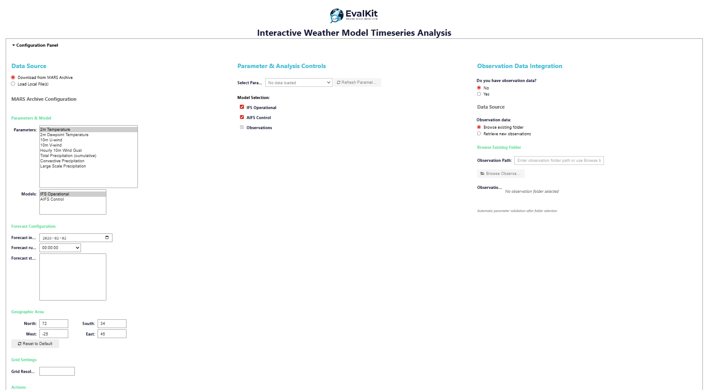

### Step 1: Get Forecast Data

**Option A: Download from MARS Archive**
1. Select **"Download from MARS Archive"**.
2. Select one or more models in the **Models** list:

   | Model | MARS | Steps |
   |---|---|---|
   | **IFS Operational** | `od` | IFS variable step pattern |
   | **AIFS Control** | `ai` | 6-hourly |
   | **IFS 4.4km** | `rd` / `iekm` | hourly up to 120 h |
   | **Hybrid IFS** | `rd` / `iueu` | 3-hourly up to 240 h |
   | **RD Experiment** | user-defined | IFS variable step pattern |

   When **RD Experiment** is selected, two extra fields appear: **Class** (default `rd`) and **Exp. version** (e.g. `iekm`). Use them to retrieve any research experiment.
3. Set the forecast initialisation date, end date and run time.
4. Define the geographic area by drawing a bounding box on the map or entering coordinates manually.
5. Set grid resolution if needed.
6. Click **"Preview"** to review, then **"Retrieve Data"**.

**Option B: Load Local Files**
1. Select **"Load Local File(s)"**.
2. Each configured model has its own **Browse** button and path box (**Browse IFS**, **Browse AIFS**, **Browse IFS4KM**, **Browse HYBRID**, **Browse RD**). Select files for the models you have, or paste the GRIB paths directly.
3. Click **"Load File"** to process the selected files, and verify success in the Loading Summary panel.

### Step 2: Select Analysis Parameter

1. Choose the parameter to analyze from the **Select Parameter** dropdown. As well as the retrieved fields, derived parameters are added automatically when their inputs are loaded:

   | Loaded input | Derived parameters offered |
   |---|---|
   | `10u` + `10v` | 10m Wind Speed (calculated), Daily Mean 10m Wind Speed |
   | `10fg` (hourly gust) | Max 6h / 12h / 24h / 48h Wind Gust (rolling maximum) |
   | `2t` | Daily Maximum / Minimum 2m Temperature |
   | `2d` | Daily Maximum / Minimum 2m Dewpoint Temperature |
   | `tp`, `cp`, `lsp` | Deaccumulated precipitation, with the **Accumulated period** chosen from 6 / 12 / 24 / 48 hours |

2. Choose display units where relevant: **Temperature** in °C or K, **Precipitation** in mm or m.
3. Check the boxes for the models you want to compare. There is one checkbox per configured model, labelled with its display name. A checkbox stays visible but is disabled when no data is loaded for that model.

### Step 3: Add Observation Data (Optional)

**If you already have observation data:**
1. Select **"Yes"** for "Do you have observation data?".
2. Select **"Browse existing folder"** or paste in its path.
3. Click **"Browse Observations"** to select the folder — the system automatically validates parameter compatibility.

**If you need to retrieve observation data:**
1. Select **"Yes"**, then **"Retrieve new observations"**.
2. Configure the VINO path to your `vino_getgeo` executable (default `/home/moz/bin/vino_getgeo`).
3. Choose data sources (SYNOP, HDOBS, or both).
4. Set the observation **Period** (6, 12 or 24 hours) for period-based parameters, plus the start and end dates. Retrieval times are chosen automatically for the parameter:
   - Instantaneous parameters (`2t`, `2d`, `10ff`) are retrieved every 3 hours.
   - Daily temperature extremes are 24 h values at 00 UTC. The ECMWF short names `mx2t`/`mn2t` are translated automatically to the VINO names `tmax`/`tmin`.
5. Choose an output folder and click **"Retrieve Observations"**.

Once loaded, check the **"Observations"** box to include it in your analysis.

After loading, observation stations are coloured by their value, with a colour bar. Use **◀ Prev** / **Next ▶** under *Explore observation lead times* to step through the observation times.

> ℹ️ Observations are **not** trimmed to the forecast window. If the observation and forecast time ranges differ, an information message shows both ranges, and each dataset is plotted over its own full period. Plotting is not blocked.

### Step 4: Select Analysis Points

1. Click within your defined geographic area on the map, or add coordinates manually.
2. Selected points appear as colored markers; select multiple points to compare locations.
3. Click an observation station (if loaded) to select it. Click it again to deselect it; it then returns to its value colour, or grey if it has no value at the current time.

### Step 5: Analyze Results

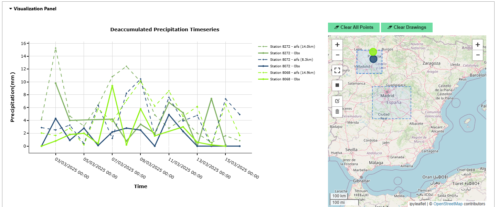

1. View the time-series chart for all selected points.
2. Each point/station has a unique color matching its map marker.
3. Use the chart toolbar for zooming and detailed inspection.
4. Compare forecast models against observations directly.

### Step 6: Manage Your Analysis

- **Clear All Points** — remove all selected forecast points and observation stations. The station markers stay on the map.
- **Clear Drawings** — remove bounding boxes from the map.
- **Modify Selection** — click existing points to remove them, or add new ones.

### Typical Workflow

1. **Get Data** — download from MARS or load local files.
2. **Choose Parameter** — select what to analyze.
3. **Add Observations** — load observation data if available.
4. **Select Points** — click on the map to choose analysis locations.
5. **Compare** — view time-series plots of forecasts vs. observations.

---

## 📊 Probabilistic Forecast Tool

**EvalKit — Probabilistic Forecast Analysis Tool**

### Overview

Provides ensemble forecast visualization and uncertainty quantification through four analysis types:

1. **Meteogram** — time series for a single location across the forecast range.
2. **Plumes** — ensemble spread visualization for uncertainty analysis.
3. **Stamps** — spatial ensemble-spread plots for a specific forecast date and step.
4. **CDF** — cumulative distribution functions from climate data.

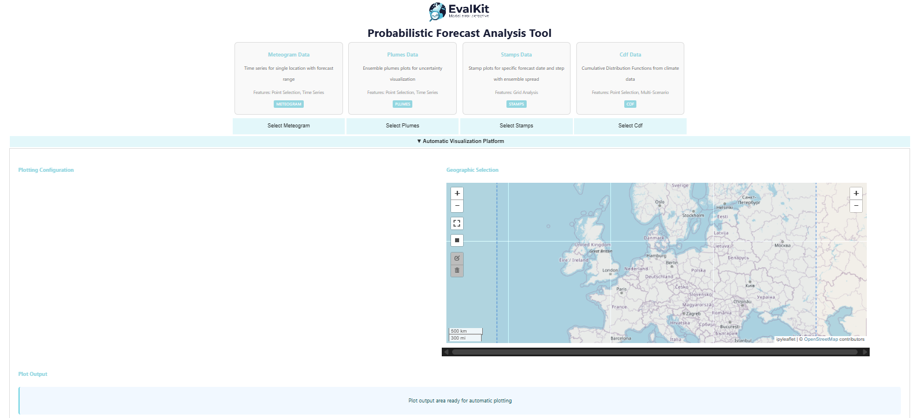

### Step 1: Select Plot Type

Choose your desired analysis type from the four options at the top of the interface.

### Step 2: Configure Your Data Source

The interface adapts based on the selected plot type.

#### Option A: Download from MARS Archive

**For Meteogram and Plumes:**

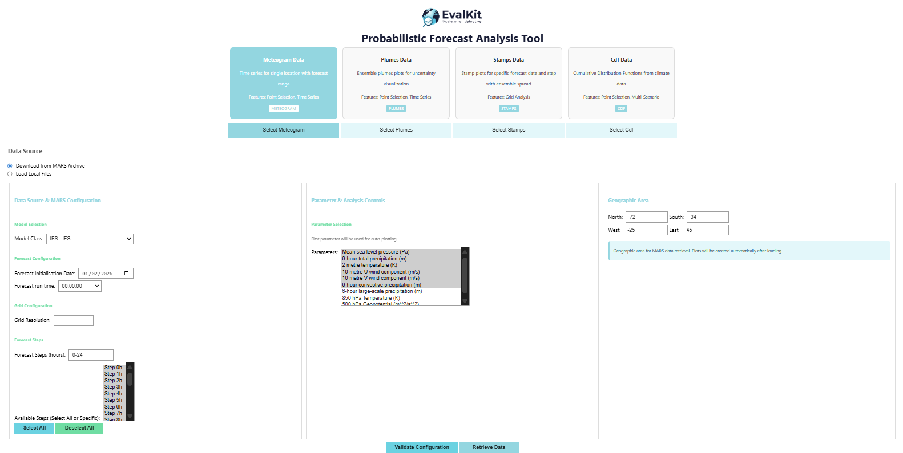

1. **Models**, **Forecast Initialization Date**, and **Forecast run time**. Tick one or more model checkboxes (IFS-ENS is ticked by default):

   | Model | MARS | Notes |
   |---|---|---|
   | **IFS-ENS** | `od` / `1` | deterministic, control + 50 perturbed members, climate (hindcast) data for CDF |
   | **AIFS-ENS** | `ai` / `0001` | deterministic (AIFS-single), control + 50 perturbed members |
   | **AIFS-Single** | `ai` / `0001` | deterministic only |
   | **IFS 4.4km** | `rd` / `iekm` | deterministic only |
   | **Custom Experiment** | `rd` / user-defined | deterministic, control + 50 perturbed members |

   For Meteogram and Plumes, every ticked model is retrieved and plotted, so models can be compared at the same point. When **Custom Experiment** is ticked, set its **Class** (default `rd`), **Expver**, and whether to **Include Control Forecast (CF)**.

2. **Grid Resolution** (leave empty for reduced Gaussian grid).
3. **Forecast Steps**: a range (default `0-240`) or specific steps, plus a **Frequency** (1-hourly, or 3-, 6-, 12- or 24-hourly). With several models, each model uses its own native steps limited to that frequency. Review the steps in the scrollable "Available Steps" list, with **Select All**/**Deselect All** helpers.
4. **Parameter Selection** from the scrollable list.
5. **Geographic Area** (North/South/West/East), settable via the interactive map or manual entry.
6. **Validate Configuration**, then **Retrieve Data**. Use **Save to File** to write the loaded data as GRIB under `$SCRATCH/evalkit/<meteogram|stamps|cdf>/`, so you can reload it later with *Load Local Files*.

This retrieves both **perturbed forecasts** and the **control forecast** for each selected parameter.

> 📝 Configuration and loaded data are preserved when switching between Meteogram and Plumes, since both use the same input data structure.

**For Stamps:** the same configuration sections apply (models, date/time, grid, steps and frequency, parameters, area). Stamps uses the **first** ticked model. Retrieves the **control forecast**, the **perturbed forecasts** (ensemble members), and the **deterministic forecast**. Precipitation is kept as the raw cumulative field, so you can choose any accumulation window at plot time.

**For CDF:**

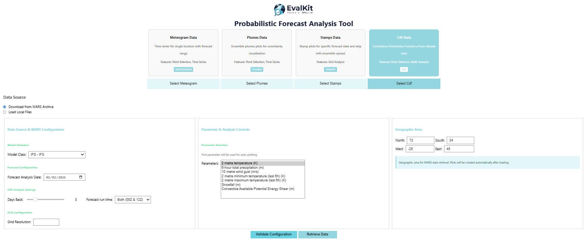

1. **Models** and **Forecast Analysis Date**. CDF uses the **first** ticked model; climate data is available for IFS-ENS.
2. **Days Back** (slider) — how many days back from the analysis date to look.
3. **Forecast run time** — which initialization times to include (e.g. Both 00Z & 12Z).
4. **Grid Resolution** and **Parameter Selection**.
5. **Geographic Area**, then **Validate Configuration** / **Retrieve Data**.

This retrieves climate data and perturbed forecasts for each day/run time within the lookback period, enabling CDF analysis.

#### Option B: Load Local Files

For all plot types, you can load previously downloaded files instead of retrieving from MARS.

- **Meteogram/Plumes**: requires an **Ensemble Forecast File** and a **Control Forecast File**.

  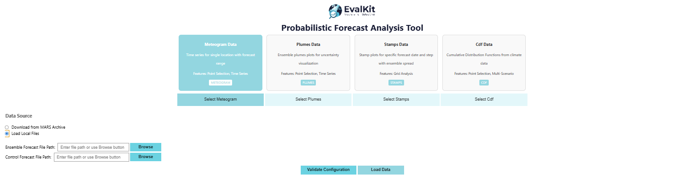

- **Stamps**: requires a **Deterministic**, **Control**, and **Ensemble** forecast file.

  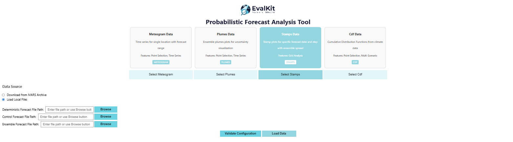

- **CDF**: requires a **Climate Data File** plus one file per scenario (e.g. `D-0_00Z`, `D-0_12Z`, `D-1_00Z`, ...), where `D-N` means N days back from the analysis day. Use **"Add More Scenario Files"** / **"Delete"** to manage rows.

  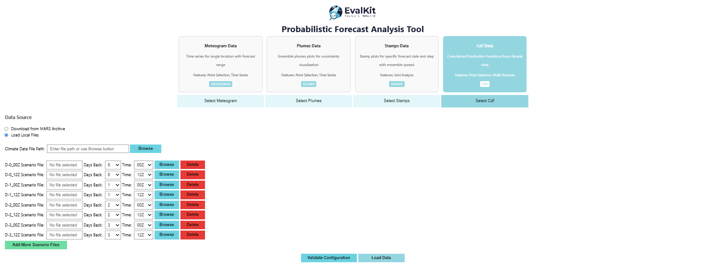

In every case: **Validate Configuration** to verify your files, then **Load Data**.

### Step 3: Observation Data Integration (Optional, Meteogram & Plumes only)

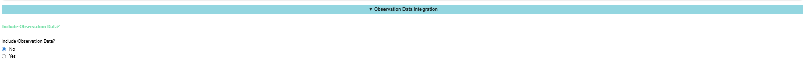

Select **"Yes"** to enable model-observation comparison, then choose:

**Option A: Browse Existing Folder** — select a local folder that already contains observation files.

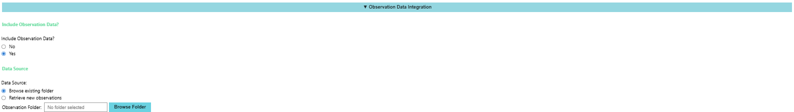

**Option B: Retrieve New Observations** — download fresh observation data using VINO:

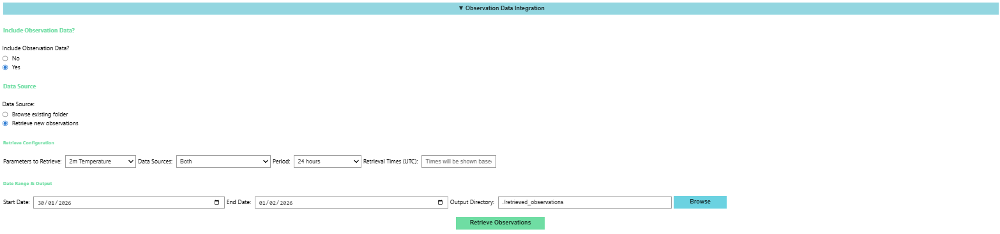

1. **Parameters to Retrieve** (2m Temperature, 2m Dewpoint, Total Precipitation, 10m Wind Speed, 10m Wind Gust, Maximum/Minimum Temperature), **Data Sources** (SYNOP, HDOBS, or both), and **Period** (6, 12 or 24 hours, for period-based parameters like precipitation, wind gust, or temperature extremes).
2. **Retrieval Times (UTC)** are computed automatically from the parameter/period (e.g. instantaneous parameters are retrieved every 3 hours: 0, 3, 6, 9, 12, 15, 18, 21 UTC).
3. **Start Date**/**End Date** (`DD/MM/YYYY`) and an **Output Directory**.
4. Click **"Retrieve Observations"**.

Once loaded, observation stations are coloured by their observed value, with a colour bar. Use **◀ Prev** / **Next ▶** to step through the observation times.

### Step 4: Automatic Visualization Platform

**For Meteogram and Plumes:**

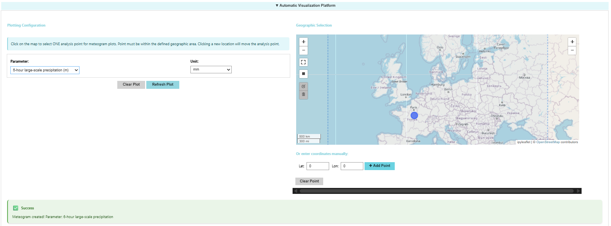

1. Choose a **Parameter** and preferred **Unit** from the dropdowns.
2. Click on the map to select **one** analysis point (or enter Lat/Lon manually and click **"+ Add Point"**).
3. The plot is generated automatically once a point is selected. When several models were retrieved, each one is plotted with its own label.

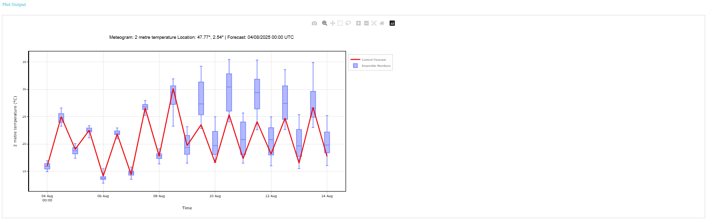

- **Meteogram**: red line = control forecast; blue boxes = ensemble member spread.
- **Plumes**: orange line = control forecast; shaded green bands = ensemble spread (0–100%, 5–95%, 25–75% IQR), with the darkest line showing the median.

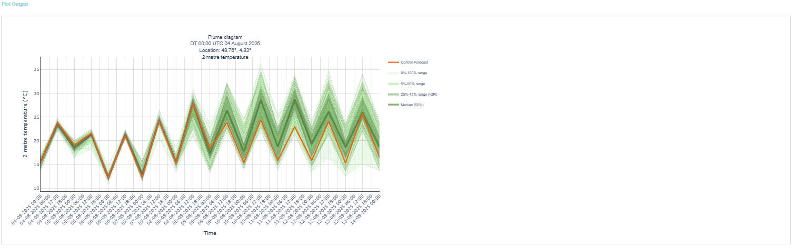

> 📝 Switching between Meteogram and Plumes preserves your configuration and data for the same location/parameter.

**For Stamps:**

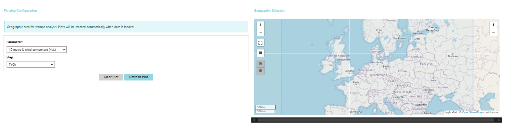

Select a **Parameter**, **Unit** and **Step**. For precipitation (`tp`, `lsp`, `cp`), also choose:

- **Precip Accumulation**: the window ending at the selected step — 3, 6, 12, 24 (default), 48, 72 or 120 hours. Only steps whose window start is also in the data are offered.
- **Palette**: Basic (0.5–500 mm), Extended (0.5–100 mm) or High Intensity (10–700 mm).

The plot shows a grid of individual ensemble members (MEM 01, MEM 02, ...) plus the control member.

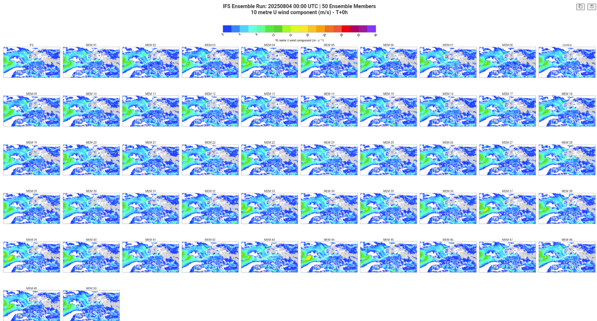

Key information displayed: ensemble run date/time, number of members, parameter name/units, and forecast step (T+hours).

**For CDF:**

Select a **Parameter**, then click on the map (or enter Lat/Lon) to select one analysis point. The cumulative distribution function plot shows the statistical distribution of the parameter across all scenarios.

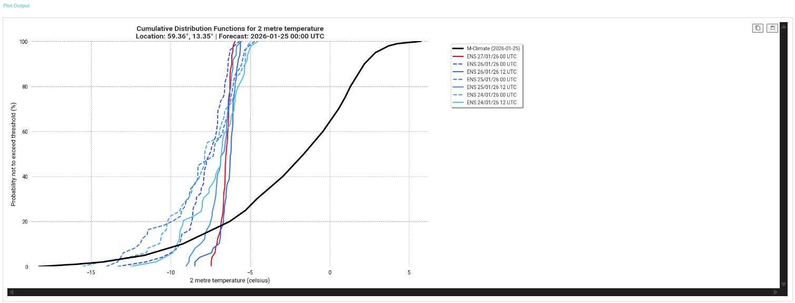

> 💡 CDF plots are particularly useful for understanding the probability distribution of extreme events, or for comparing forecast reliability across different initialization times.

---

## 🧪 Case Study Tool

**EvalKit — model vs. observations case-study evaluation** (`case_study_tool/`)

Describe a case in one YAML file. The tool retrieves the forecasts from MARS and the SYNOP/HDOBS observations from VINO, then writes the figures and score tables. It works for any area, date, model or experiment.

### Quick start

```bash
PY=/usr/local/apps/python3/3.13.13-01/bin/python3       # needs earthkit-data, cartopy, shapely, pyyaml
$PY case_study_tool/run_case.py template -o my_case.yaml  # commented template
$PY case_study_tool/run_case.py plan my_case.yaml         # dry run: runs, steps, observations, checks
$PY case_study_tool/run_case.py run  my_case.yaml         # retrieve, verify, plot
$PY case_study_tool/run_case.py models                    # list model presets
```

Ready-made examples are in [`case_study_tool/configs/`](case_study_tool/configs/): Iberia (Feb 2026), Tuscany (Oct 2024), the Valencia DANA (Oct 2024), Catalonia (Oct 2026), the California atmospheric river (precipitation) and the Pacific NW bomb cyclone (maximum wind). The full reference, including every option, is in [`case_study_tool/README.md`](case_study_tool/README.md).

Run `plan` before `run`. It needs no retrieval and warns about every model and lead time that cannot be retrieved (no such cycle, step not archived, lead shorter than the window) and about region names that match nothing. Unknown or misspelt keys in the YAML file are rejected.

### What you configure

| Key | Meaning |
|---|---|
| `variable` | `tp` (precipitation) or `ws10` (10 m wind speed) |
| `window.end`, `window.hours` | End and length of the verification window (UTC). `hours: 0` = instantaneous |
| `window.statistic` | `sum` for `tp`; `instant`, `max` or `mean` for `ws10` |
| `leads` | Lead times to the **end** of the window. The model run is `end − lead`, and steps are derived automatically |
| `models` | Presets `ifs`, `aifs`, `destine` (`iekm`, falling back to `i4ql`), `pilot_dt` (`j5j2`). Use `{preset: destine, expver: xxxx}` for another experiment (labelled "DestinE xxxx"), or give any MARS experiment with `class`, `expver` and optionally `label`, `stream`, `type`, `cycles`, `step_rules`. Each model needs a unique label |
| `domain.extent`, `domain.zooms` | Main map `[W, E, S, N]` plus optional zoom maps. Each gets its own figures |
| `region` | Optional outline for statistics, drawn on the maps: `countries`, `admin1` (e.g. `{country: Italy, regions: [Toscana]}` or `{country: Spain, regions: [Valenciana]}`) or `box`. Without it, statistics cover the whole main domain, sea included |
| `observations` | `sources` (SYNOP/HDOBS), `min_coverage` (share of reports a station needs), `vino_path` |
| `thresholds` | Thresholds for the categorical scores |
| `plot` | `style` (`contour` or `gridbox`), `levels` (`null` = automatic colour scale), `orography` (also limits the region max/mean to model land points) |
| `output_dir`, `cache_dir` | Optional. Relative paths resolve from the repository root |

### How observations are matched

- **Precipitation over N×24 h:** daily `tp24` totals ending at the window's end hour are summed per station.
- **6 or 12 h precipitation:** the `tp` report for that period is used directly.
- **Wind:** `10ff` at the valid time (`instant`), or the maximum or mean of the 3-hourly reports over the window. Model wind statistics use 3-hourly outputs (6-hourly for AIFS).
- **Gaps:** stations below `min_coverage` are dropped. Duplicate SYNOP/HDOBS reports of the same gauge are merged.

### Outputs (`case_study_tool/output/<name>/`)

- **Panels:** `panel.png` (and `panel_<zoom>.png`). Rows are lead times; columns are the observations followed by each model. Each model title gives the run, the steps, the maximum inside the region (marked × on the map), and the station bias, RMSE and correlation.
- **Maps:** `observations.png` (gauges only) and `orography.png` (each model's terrain, sea masked with its own land–sea mask).
- **Scores:**
  - `scores.png`: bias, RMSE and correlation bars, plus ETS against threshold.
  - `scores.csv`: region max/mean and station scores per model and lead.
  - `categorical_scores.csv`: hits, misses, false alarms, POD, FAR, frequency bias and ETS per threshold.
- **Data:** `observations.csv`, the aggregated value per station.

Retrievals run in parallel (`--workers`, default 6) and are cached in `case_study_tool/cache/`, so re-runs only redraw. Use `--force` to re-retrieve, or `--no-obs` to skip the observations.

> ⚠️ Outputs that include HDOBS are for ECMWF internal use only.

---

## 🔬 Analysis Scripts and Case Studies

The [`analysis/`](analysis/) folder holds command-line scripts for forecast verification and case studies. They run on an ECMWF Python with `earthkit-data`, `cartopy` and `shapely` (e.g. `/usr/local/apps/python3/3.13.13-01/bin/python3`), and need MARS access and `vino_getgeo` for observations. Retrievals are cached under `analysis/data/`. Figures go to `analysis/figures/` and tables to `analysis/results/`.

| Script | Purpose |
|---|---|
| `analysis/run_analysis.py` | HRES 10 m wind-speed verification against SYNOP (RTE France case, Aug 2026) |
| `analysis/europe_map.py` | Europe-wide 10 m wind-speed bias maps |
| `analysis/drilldown.py` | Worst stations / misses on the 15 Aug 2026 wind event |
| `analysis/precip_run.py [--variant iekm]` | Baltic 24 h precipitation misplacement: event, fixed-lead (T+54 h) and predictability comparison of IFS-control, AIFS-single and Hybrid (j1l8) or DestinE (iekm) |
| `analysis/case_studies/alps_precip.py` | Alps 3-day T+24 h precipitation vs SYNOP + HDOBS gauges |
| `analysis/case_studies/catalonia_precip.py` | Catalonia MCS, 24 h precipitation (03 Oct 12 UTC → 04 Oct 12 UTC 2026) at T+60 h and T+36 h |
| `analysis/case_studies/crete_precip.py` | Crete, 5-day (T+0–120 h) precipitation, plotted per native grid box, plus observed 5-day SYNOP + HDOBS station totals |
| `analysis/case_studies/crete_orography.py` | Crete, model orography with 10 m wind barbs at T+24 h |
| `analysis/case_studies/iberia_precip_20260204.py` | Iberia, 24 h precipitation on 4 Feb 2026 (577 mm at Grazalema) at T+24 h and T+48 h, with an Andalusia zoom |
| `analysis/case_studies/toscana_precip.py` | Tuscany, 24 h precipitation on 18 Oct 2024 at T+24 h and T+48 h, per native grid box |
| `analysis/case_studies/california_ar_2024.py` | California atmospheric river / Pacific NW bomb cyclone, Nov 2024: 4-day precipitation and 48 h maximum 10 m wind |

The case studies compare **IFS-control** (`od/0001`), **AIFS-single** (`ai/0001`), **DestinE** (`rd/iekm`) and the **Pilot DT** (`rd/j5j2`) at each model's native resolution. Lead times always refer to the **end** of the accumulation window. Example:

```bash
python analysis/case_studies/crete_precip.py          # uses cached data if present
python analysis/case_studies/crete_precip.py --force  # re-retrieve from MARS / STVL
```

For a new precipitation or 10 m wind case, prefer the [Case Study Tool](#-case-study-tool): it only needs a YAML file. Scripts in `analysis/case_studies/` are for analyses the tool does not cover (e.g. wind barbs or custom diagnostics). See [analysis/README.md](analysis/README.md) for each script's details, outputs and conventions.

> ⚠️ HDOBS observations are for ECMWF internal use only. Do not distribute figures or tables derived from them outside ECMWF.

---

## Customization and Extensibility

Both notebook tools are designed to be **scalable and customizable** — you can extend them to support additional weather models and parameters by editing their configuration files. Each tool has its own copy of these files:

| Tool | Config file | Styling file |
|---|---|---|
| Clickable Timeseries | `clickable_timeseries/helpers/config.json` | `clickable_timeseries/helpers/plotting/styling_config.py` |
| Probabilistic Forecast Tool | `probabilistic_forecast_tool/helpers/model_config.json` | `probabilistic_forecast_tool/helpers/styling_config.py` |
| Analysis pipelines | `analysis/config.py` (wind), `analysis/precip_config.py` (Baltic precip) | per-script colour levels |
| Case Study Tool | one YAML file per case (`case_study_tool/configs/`); model presets in `case_study_tool/casetool/models.py` | `case_study_tool/casetool/plotting.py` (automatic, or `plot.levels` in the YAML) |

In the Case Study Tool, a new experiment needs no code change. Add it to `models` in the case YAML, with its `class` and `expver`. Case-study scripts in `analysis/case_studies/` keep their settings (dates, area, models, colour levels) as constants at the top of each file.

### Adding a New Model

Add an entry to the tool's `config.json` (or `model_config.json`) describing the model's MARS `class`, `stream`, `type`, `levtype`, step pattern, and whether it supports custom step expansion:

```json
"new-model": {
  "display_name": "New Model Name",
  "class": "od",
  "stream": "oper",
  "type": "fc",
  "levtype": "sfc",
  "step_pattern": "six_hourly",
  "supports_custom_step_expansion": false,
  "description": "Description of the new model",
  "ui_order": 3
}
```

### Adding a New Parameter

Add an entry describing the parameter's MARS `param_id`, display name, units, and which models it's available for:

```json
"new_param": {
  "param_id": 999,
  "name": "New Parameter Name",
  "display_name": "Display Name",
  "units": "unit",
  "description": "Parameter description",
  "available_models": ["model-name"],
  "category": "category_name",
  "ui_order": 10
}
```

> ⚠️ **Step compatibility**: parameters with different temporal resolutions (e.g. 6-hourly vs. 1-hourly) should not be mixed in the same analysis. For example, the 10m Wind Gust parameter (`10fg6`) typically has 6-hour intervals, while parameters like 2m Temperature may have 1-hour intervals — mixing incompatible step configurations can cause data alignment issues.

### Customizing Visualization Styling

Edit the tool's `styling_config.py` to control color palettes, contour level definitions, unit conversions, and parameter categorization:

1. Add your parameter to the appropriate category in the `parameter_types` (or equivalent) dictionary.
2. Define a color palette and levels if introducing a new parameter type.
3. Add title formatting in the relevant `_get_*_title()` method.
4. Add unit conversion logic in `transform_data_and_levels()` if needed.

```python
self.parameter_types = {
    # Existing categories...
    "new_category": ["new_param1", "new_param2"],
}

# Define colors and levels for the new category
self.new_category_colors = [
    "rgb(0,0,255)",
    "rgb(0,255,0)",
    # ... more colors
]
self.new_category_levels = [0, 10, 20, 30, 40, 50]
```

---

## Tips for Best Results

- Start with smaller geographic areas and shorter time periods for initial exploration.
- Always preview/validate your configuration before retrieving large datasets from MARS.
- Draw bounding boxes directly on the map for precise geographic area selection.
- When using observations, check that their period overlaps your forecast. Both datasets are always plotted over their full available periods, and an information message shows the two ranges when they differ.
- Use the observation **Period** that matches the derived forecast parameter, e.g. 24 h observations with the 24 h deaccumulated precipitation or Max 24h Wind Gust.
- In the Probabilistic Forecast Tool, switching between Meteogram and Plumes (or reusing a Stamps/CDF configuration) preserves your data and configuration, since they share the same underlying inputs.

## Getting Help / Contributing

- For environment setup issues, see [GETTING_STARTED.md](GETTING_STARTED.md).
- To report issues or contribute changes, see [CONTRIBUTING.md](CONTRIBUTING.md) for the development workflow, linting, and pull request guidelines.
